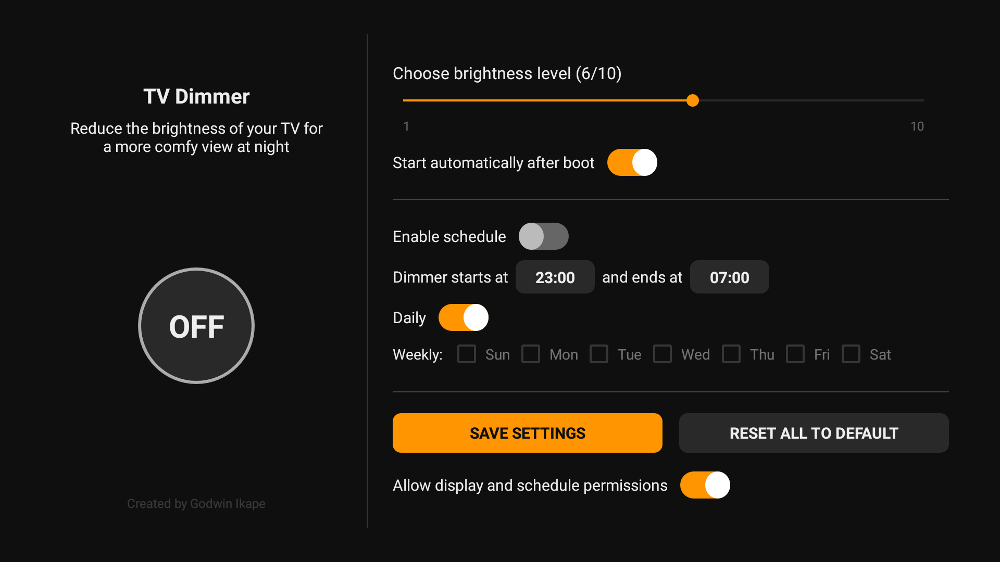

# TV Dimmer 1.6.8

Native Android TV dimmer for personal sideloading, Android 8 or later. No internet permission, analytics, accounts or third party runtime libraries.

- At launch, remote focus starts on the ON/OFF circle, so the first OK press toggles dimming. While OFF, its white outline breathes gently; the animation stops when the activity is paused. Pressing Right from the circle selects the brightness slider without changing its value. At brightness 10, further Right presses keep focus on the slider and do nothing; other directions behave as before.
- Press ON/OFF to override dimming until the next schedule boundary, standby or restart.
- While the dimmer is OFF, remote or touch slider adjustments only save the selected brightness level; the screen stays at normal brightness. Turning the dimmer ON applies that selected level. While ON, slider changes apply immediately and the chosen brightness continues after leaving the app.
- Level 1 leaves about 5% of the rendered picture; level 10 removes the overlay.
- Daily schedules all days. For weekly/custom recurrence, switch Daily OFF and select one or more weekday checkboxes.
- Default times remain 23:00 to 07:00. Click a time to type hours and minutes or use remote Up/Down. Right moves from hours to minutes, then Set; Left moves back. Invalid and equal start/end times are rejected. An earlier end means the following morning.
- SAVE SETTINGS commits the form and shows the existing confirmation toast. Saving an enabled schedule resumes automatic timing and clears the manual override.
- The permission switch reflects actual overlay and precise schedule access and opens Android Settings via a chooser.
- RESET ALL TO DEFAULT stops dimming, clears preferences and cancels alarms. Special permissions must still be revoked by the user in Android Settings.

The optional **Buy me a coffee** button shows a Stripe QR code you can scan with your phone. All app features are free.

## Installation

Install the supplied APK on the TV stick. If Android reports a signing conflict with an earlier build, uninstall the old app first, which clears its preferences. The package name is com.example.tvdimmer, versionCode 18, versionName 1.6.8. For future update compatibility, keep one stable private signing key.

Grant overlay permission, test level 8 first, and then test your streaming apps. Force stop or uninstall TV Dimmer in TV Settings > Apps if you need to remove the overlay. An authorized ADB connection can also use:

    adb shell am force-stop com.example.tvdimmer

## Android limitations

This is a removable black overlay, not physical backlight control or privileged Extra Dim. Some apps and system windows hide overlays and may remain bright. Very dark overlays may block mouse/touch passthrough to other apps on newer Android versions; the TV remote is the intended control. Dimming the settings screen at very low levels can make it harder to read; level 10 restores normal visibility.

Startup needs an initial launch and overlay permission. Some Android TV manufacturers restrict background starts, so automatic startup may vary by device and firmware. Force stopping prevents automatic work until the app is reopened. Alarms use local TV time. Each selected start day owns its following overnight end. No root or accessibility service is required.
